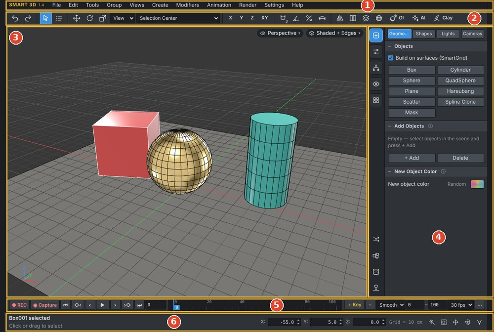
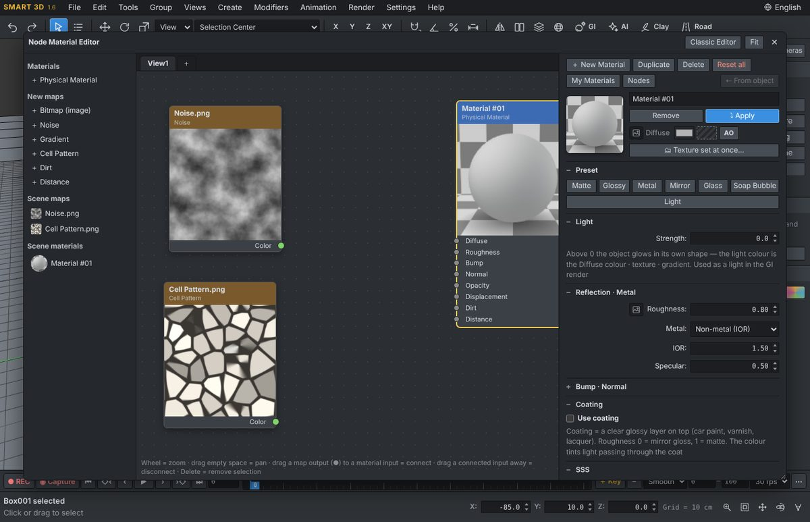
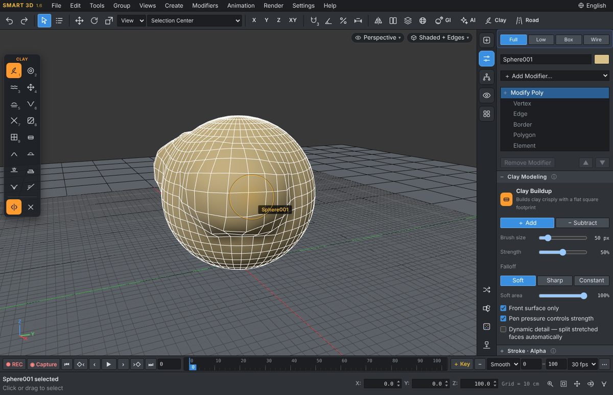
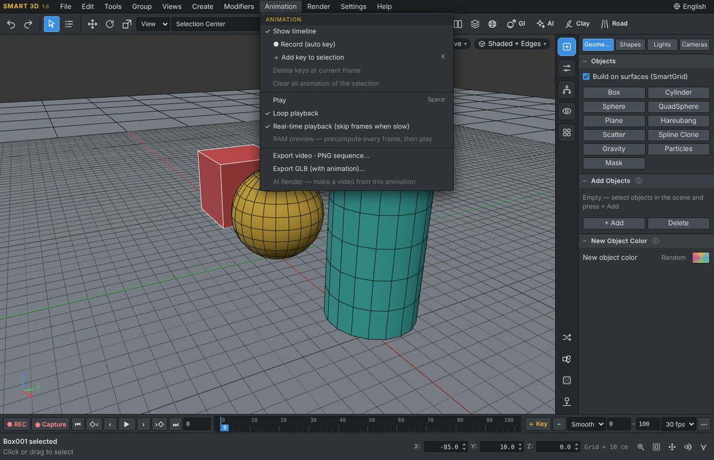
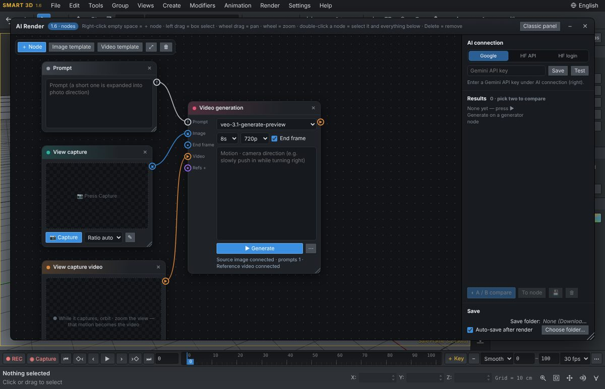
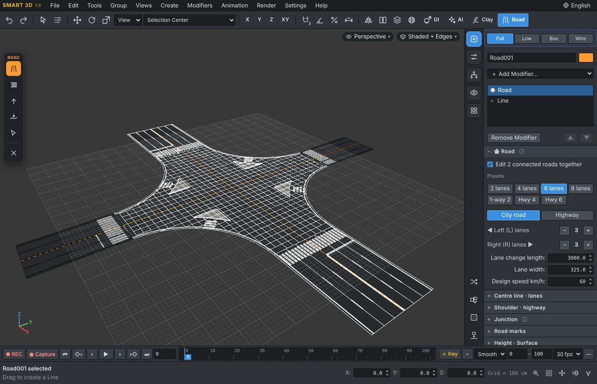
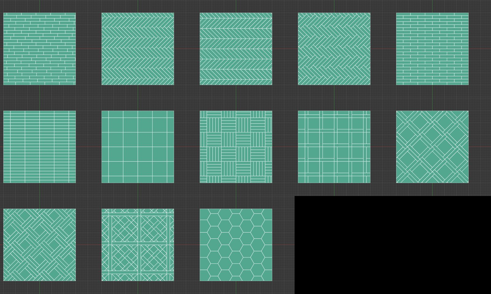
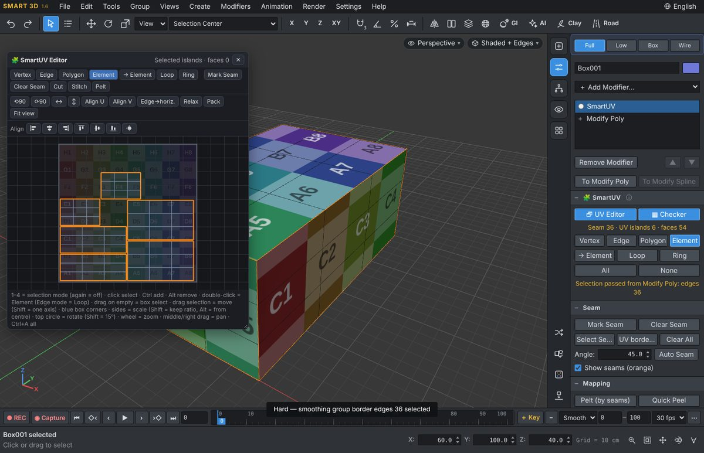
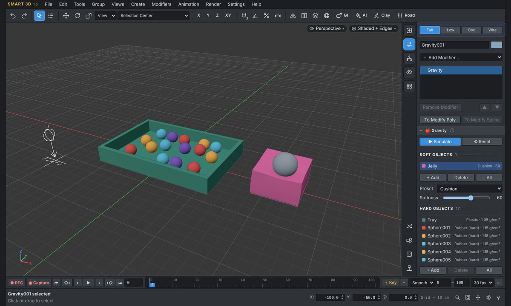

# SMART 3D

English · **[한국어](README_KO.md)**

A web-based 3D modeling tool — modeling, animation and AI image / video rendering in one program.
Free to use as a **Windows program (SMART3D.exe)** that runs without installation, or as an **HTML version** that opens in your browser.

## Download

**[⬇ Get it from the Releases page](https://github.com/xxxxskyxxx/SMART-3D/releases/latest)**

| File | Language | Description |
|---|---|---|
| `SMART3D_EN_v1.5.exe` | English | Windows executable — double-click to run (no installation) |
| `SMART3D_KO_v1.5.exe` | Korean | Windows executable (Korean UI) |
| `SMART-3D_EN_v1.5_html.zip` | English | HTML version for Chrome / Edge + help |
| `SMART-3D_KO_v1.5_html.zip` | Korean | HTML version (Korean UI) + help |

> **First run:** if Windows shows “Windows protected your PC”, click **More info → Run anyway**. (It appears because this independent program is not code-signed.)

## Features

**What’s new in 1.5** — **Road** tool with Korean road rules (lanes, junctions, crosswalks, road marks, on terrain), **Clay+** (new brushes, strokes · alphas, radial symmetry, layers, soft area, dynamic detail, clip), **FloorGen** with 13 parquet patterns and clean cuts, **SmartUV** (seams · Pelt · auto stitch · Cut / Stitch · Loop / Split UV · Arrange · UV editor with transform box and align icons), **Gravity** rigid / soft body simulation, **Sun Sky** environment, **Claude 3D** (image → model with studio / interior / architecture lighting), Scale gizmo plane handles with Shift+Scale new faces, a **Voxel** modifier (fill with boxes or any source object), **AI · SVG import** with **Optimize Shape** (clean splines with the fewest points), **VectorGen** (image → splines in Create ▸ Shapes), and Shift+drag polygon extrude that cleans up faces with no thickness. Full list: [Release notes](https://github.com/xxxxskyxxx/SMART-3D/releases/latest) · [CHANGELOG](CHANGELOG.md)

- **Modeling** — primitives and splines, Modify Poly / Modify Spline editing (Extrude, Inset, Bevel, Chamfer, Bridge, Connect, Trim…), modifier stack (Multi Select, Projection Spline, Pattern surface tiling (tri · quad · hex), Shell, Noise…), Boolean, Mirror, Mask objects, SMART Utils ▸ Drop Surface; **SmartGrid** builds right on a surface, a new object switches to Modify (right-click a create button for continuous create ∞)
- **Selection** — Select Similar (objects with the same structure at any size, or matching elements), Dot Select (every N along a line, on every selected part), View Select (polygons facing the view within an angle, live while dragging), select a smoothing group by double-clicking its number
- **Road (1.5)** — draw road centre lines with Korean road rules: lane counts and widths, centre line types, shoulders, highway median, bus lanes, junctions · T · L with rounded corners, traffic islands, automatic crosswalks and stop lines, lanes per segment with smooth tapers, composable road marks placed per lane, roads on terrain or with their own height
- **Clay Modeling** — sculpt any object like clay (Clay · Inflate · Smooth · Move · Flatten · Crease · Pinch · Mask · Detail, symmetry, pen pressure); **1.5**: Clay Buildup · Draw · Scrape · Polish · Layer · Carve · Clip brushes, strokes and alphas, radial symmetry, box / lasso masks, sculpt layers, soft area, dynamic detail and un-subdivide
- **FloorGen (1.5)** — floor boards on any flat face or closed spline: Straight · Herringbone · Chevron · Double Herringbone · Brick · Stack · Checkerboard · Mosaic · Chantilly · Basket Weave · Double Basket · Versailles · Hexagon; holes and segmented planes cut cleanly, random Material IDs · UV · Rotate per board
- **Claude 3D (1.5)** — middle-click the SMART 3D logo (hidden): images or a multi-view sheet (+ optional prompt) → a fabrication-minded model built from SMART 3D parts through your own Claude Code or an API key, with real-world UVs, materials from your PBR texture folder, an editable 1.5 mm product chamfer and lighting by category (product photo studio with sweep backdrop and softboxes · interiors keep their lights · architecture with Sun + Sky / HDRI)
- **Gravity (1.5)** — Create ▸ Geometry ▸ Gravity: rigid (Hard) and soft body simulation on the Grid floor; add objects by click or box drag, hard presets set the weight (wood · plastic · steel · aluminium · glass · stone · rubber · styrofoam), soft presets jelly · rubber · sponge · cushion · clay with a softness slider; complex objects run on a light particle proxy
- **Sun Sky (1.5)** — a Sun light turns the environment into a sky that follows the sun elevation (blue day · low sun · sunset · night) for GI renders and the viewport; an HDRI always wins
- **SmartUV (1.5)** — a SmartUV modifier for any object (UV editor opens by itself, Modify Poly selections and Hard edges pass straight in): seams and Pelt (auto relax · texel size · auto stitch), Quick Peel, Loop UV (straighten a loop), Split UV (FloorGen boards in neat rows), Pack · texel · orient, move · rotate · align-to-edge the texture right on the object, Cut along edges / selection borders and Stitch polygons to their neighbours, a UV editor with Vertex · Edge · Polygon · Element selection, a scale / rotate transform box, align icons, checker map
- **Quad Remesh** — even quads that keep the shape; the desktop app runs the AutoRemesher 1.2.0 engine
- **Cloth** — real-time cloth: fabric presets, wind, collision, sewing, pins, freeze by selection; frozen parts can move or follow another object
- **Instances · Proxy · Groups** — Clone makes instances, display Full / Low Poly / Box / Wire Box, Scatter as GPU instances, Save as Proxy (.s3dproxy), Group menu (Ctrl+G · Open · Close · Add · Detach · Explode), auto Lights / Cameras layers
- **Copy** — Shift+drag, then set a count: fill between original and copy / more at the same spacing
- **Materials** — Material Editor (M) and **Node Material Editor** (Shift+M): PBR presets (matte · glossy · metal · mirror · glass · light), metal types whose colour you can change in Diffuse, **Coating** (amount %, colour, gloss roughness), transmission, **SSS**, **Displacement**, Roughness / Bump / Normal / Opacity maps, procedural **Noise · Gradient · Cell Pattern**, **Dirt** and **Distance** maps, Multi material with Material IDs, My Materials library, rendered previews, Random mapping, Color correct
- **Mapping modifier** — Box · Box Blur (soft seams) · Plane (Bend · Lattice) · Cylinder · Sphere · Spline
- **GI Render** (F9) — GPU path tracing: soft shadows, bounced light, reflections, refraction, HDRI environment, AI denoise, LUT, 4K and print sizes (A4–A0, DPI) · **Lights**: Rect · Disk · Sphere · Spot with IES
- **Cameras** — Perspective / Orthographic, Camera Clipping (Near / Far), Interior / Exterior / Product presets, 2-point perspective (vertical correction), Safe Frame ratios
- **Animation** — timeline, ● REC auto key, keys for move · rotate · scale · parameters · cameras, Modify Poly shape keys, box-select / move / copy keys, RAM preview
- **Units** — m / cm / mm for length fields, transforms and the grid
- **Import · Export** — pick a format in File ▸ Import… / Export…: GLB (with animation) · FBX · OBJ · STL · PLY, AI · SVG vector import, video (MP4/WebM) · PNG sequence; file dialog with bookmarked folders
- **Auto Dim · Drawing** — CAD-style dimensions on 3D objects (⚡ automatic, editable, PNG / PDF), drawing sheet with aligned orthographic views (KS 3rd angle · 1st angle), hidden lines, centre lines, an automatic isometric view and dimension snapping
- **AI Render 1.3 (nodes)** (F10) — connect view capture · GI render · loaded images · references (material · mood · object · person) · prompt · image / video generators on a node canvas; results side by side with A / B compare; the timeline ◉ Capture records your view moves as a video source
- **AI Render** — images and videos in one window
  - Google Gemini (image) · **Google Veo (video)**
  - **Higgsfield API** (key) · **Higgsfield Login** (plan credits, exe only) — model lists load automatically
  - AI video from the animation capture (first / last frame + reference clip), before/after compare, viewport overlay, edit marks, 1–4 images per run

| Node Material Editor | Clay Modeling |
|---|---|
|  |  |
| **Animation** | **AI Render (nodes)** |
|  |  |
| **Road (1.5)** | **FloorGen (1.5)** |
|  |  |
| **SmartUV (1.5)** | **Gravity (1.5)** |
|  |  |

## Help

- In the program: **Help ▸ Feature guide (with pictures)** · hotkey list **F1**
- Separately: [docs/SMART3D_Help_EN.html](docs/SMART3D_Help_EN.html) (download and open in a browser)

## Requirements

- **exe**: Windows 10 / 11 (64-bit)
- **HTML**: current Chrome or Edge (WebGL 2)
- AI features need an internet connection and your own account / API key for each service.

## About the AI services

- API keys and login tokens are **stored only on your PC** and are never sent to the SMART 3D developer.
- Generation costs (credits) and terms of use are those of each service (Google, Higgsfield).
- A Higgsfield API key (open.higgsfield.ai) and a Higgsfield account login (higgsfield.ai) are different services. Account login works **in the exe only**.

## License

**Freeware** — free for personal and commercial work. Everything you create with the program is yours.
Selling, modifying / redistributing or reverse-engineering the program itself is not allowed. See [LICENSE.md](LICENSE.md).

Open-source components: [THIRD_PARTY_LICENSES.md](THIRD_PARTY_LICENSES.md) (three.js, three-bvh-csg, three-mesh-bvh, three-gpu-pathtracer, oidn-web, Electron, AutoRemesher — MIT)

3ds Max is a trademark of Autodesk, Inc. SMART 3D is an independent product, not affiliated with Autodesk. Google, Gemini, Veo, Higgsfield and Claude (Anthropic) are trademarks of their respective owners.

## About this project

I built SMART 3D as a personal project for my own 3D modeling and AI rendering work, together with Claude (Anthropic), an AI coding assistant. I did the planning and testing, and the code was written through conversations with Claude. SMART 3D is an independent program and is not affiliated with Anthropic.

## Author

**xxxsky** · YouTube [joycg](https://youtube.com/joycg) · [Naver Cafe](https://cafe.naver.com/xxxsky)
