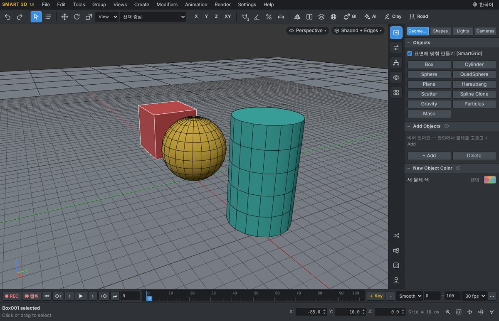
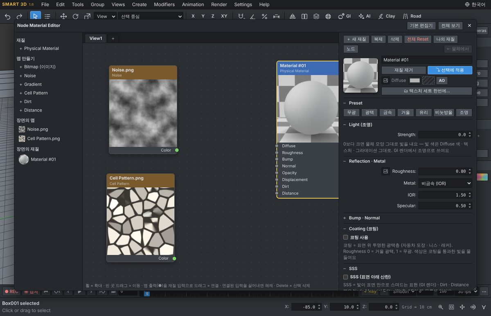
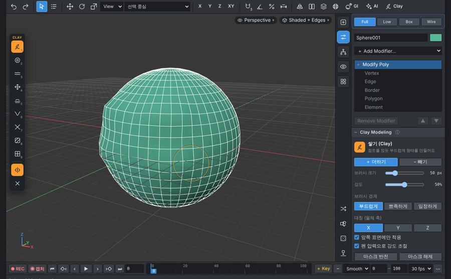
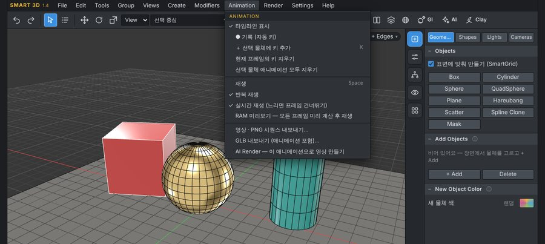
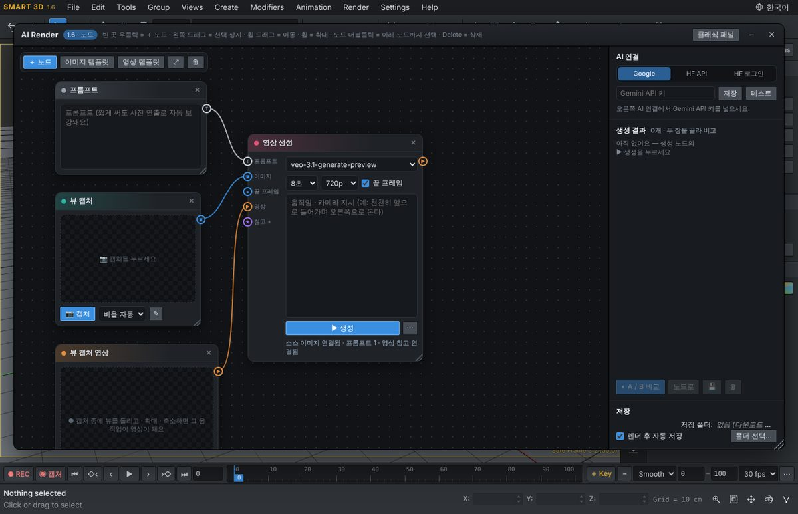
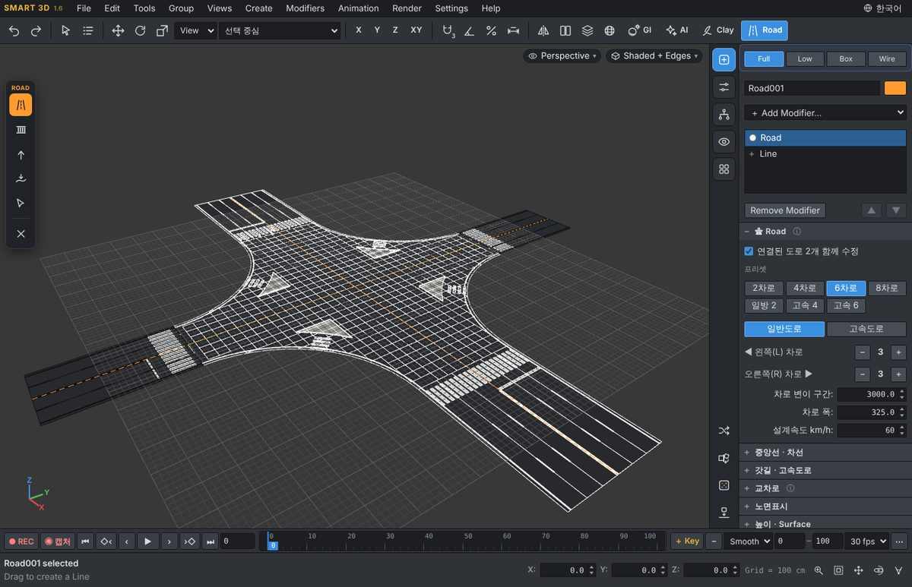
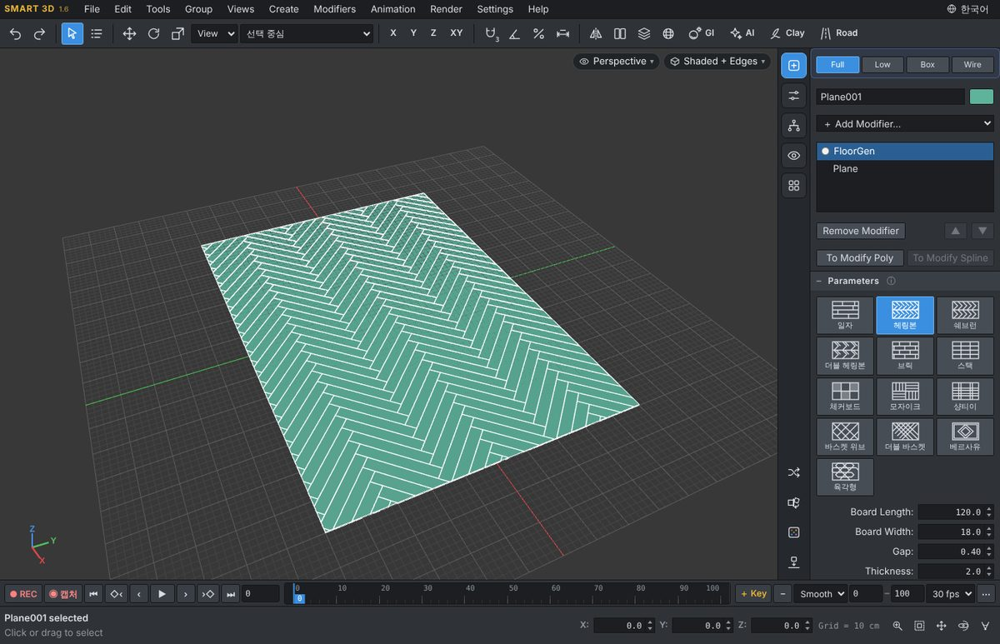
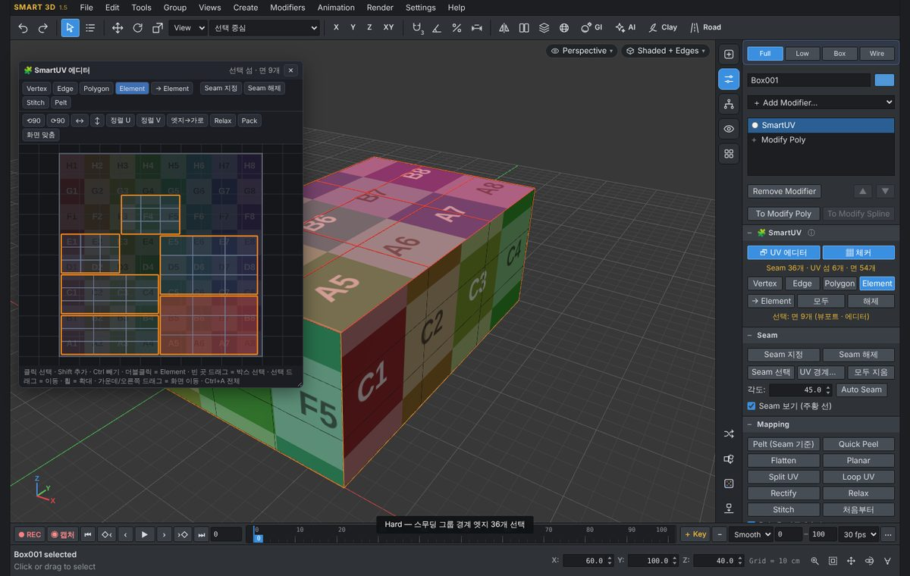
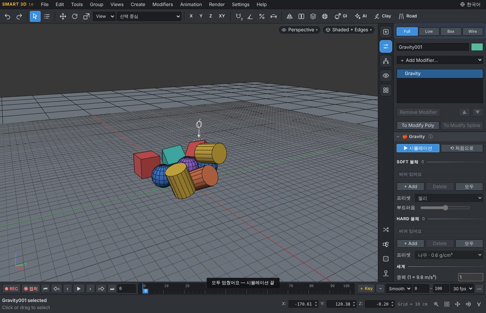

# SMART 3D

**[English](README.md)** · 한국어

웹 기반 3D 모델링 도구 — 모델링, 애니메이션, AI 이미지·영상 렌더링을 한 프로그램에서.
설치 없이 실행되는 **Windows 프로그램(SMART3D.exe)** 과 브라우저에서 여는 **HTML 버전**을 무료로 제공합니다.

## 다운로드

**[⬇ Releases 페이지에서 받기](https://github.com/xxxxskyxxx/SMART-3D/releases/latest)**

| 파일 | 설명 |
|---|---|
| `SMART3D_v1.6.exe` | Windows 실행 파일 — 더블클릭으로 바로 실행 (설치 필요 없음) · 모든 언어가 한 파일에 |
| `SMART-3D_v1.6_html.zip` | 브라우저(Chrome·Edge)에서 여는 HTML 버전 + 그림 도움말(한국어 · English) |

두 파일 모두 한국어 · English · 日本語 · 简体中文 · Español 5개 언어가 들어 있어요 — 메뉴 줄 오른쪽 🌐 버튼으로 바꾸기 (exe는 처음 실행 때 Windows 언어로 시작). 1.6부터는 새 버전이 나오면 프로그램이 알아서 알려 줘요(Help ▸ 업데이트 확인…).

> **처음 실행할 때** Windows가 “PC 보호” 창을 띄우면 **추가 정보 → 실행**을 누르세요. (코드 서명 인증서가 없는 개인 배포 프로그램이라 나오는 안내입니다.)

## 주요 기능

**1.6 새 기능** — exe 하나에 5개 언어, 메뉴 줄 오른쪽 🌐 버튼으로 한국어 · English · 日本語 · 简体中文 · Español을 바로 바꾸는 **언어 전환**(하던 장면 그대로), GitHub에서 새 버전을 확인하고 exe가 직접 받아 SHA-256 검사 후 실행까지 해 주는 **자동 업데이트**, 사각 · 원 · 구 이미터와 소스 물체(뷰포트 표시 Box / Simple / Full) · 회전 · 충돌을 갖춘 간단한 **Particles**, 스피너 ▲▼ 우클릭 = 기본값, 등각 투상도 치수를 물체 밖으로 빼고 투상도마다 선 / 셰이드+선을 고르는 **도면**, IES 파일의 배광 모양 · 세기 · 색온도를 그대로 쓰는 **IES 조명**, 더 단순해진 **편집 UI**(Modify Poly · Spline 명령은 버튼만 · 옵션은 마우스 옆 창, 뷰 나누기 경계 드래그, Mirror3D / R Clone Gizmo 이동). 전체 목록: [릴리스 노트](https://github.com/xxxxskyxxx/SMART-3D/releases/latest).

**1.5 새 기능** — 한국 도로 규칙 **Road** 도구(차로 · 교차로 · 횡단보도 · 노면표시 · 지형 위 도로), **Clay+**(새 브러시 · 스트로크 · 알파 · 방사 대칭 · 레이어 · 부드러운 영역 · 동적 분할 · 자르기), 패턴 13종과 깨끗한 절단의 **FloorGen**, Seam · Pelt · 자동 Stitch · Cut / Stitch · Loop / Split UV · Arrange · 변환 상자와 정렬 아이콘이 있는 UV 에디터의 **SmartUV**, 하드 · 소프트 물체 **Gravity** 시뮬레이션, 태양 고도를 따르는 **Sun 하늘**, 종류별 조명까지 만드는 **Claude 3D**(이미지 → 모델), 평면 핸들과 Shift+Scale 새 면의 Scale 기즈모, 박스나 소스 물체로 채우는 **Voxel** 모디파이어, **AI · SVG 가져오기**와 가장 적은 점으로 정리하는 **Optimize Shape**, 이미지를 스플라인으로 만드는 **VectorGen**, 두께 없는 면을 정리하는 Polygon Shift+드래그. 전체 목록: [릴리스 노트](https://github.com/xxxxskyxxx/SMART-3D/releases/latest) · [CHANGELOG](CHANGELOG.md)

- **모델링** — 기본 도형·스플라인, Modify Poly / Modify Spline 편집(Extrude, Inset, Bevel, Chamfer, Bridge, Connect, Trim 등), 모디파이어 스택(Multi Select, Projection Spline, Pattern 표면 타일링(삼각·사각·육각), Shell, Noise …), Boolean, Mirror, Mask 물체, SMART Utils ▸ Drop Surface. **SmartGrid**로 표면 위에 바로 만들기, 만들고 나면 Modify로 자동 이동(만들기 버튼 우클릭 = 연속 만들기 ∞)
- **선택** — Select Similar(크기가 달라도 구성이 같은 물체 · 같은 요소), Dot Select(줄을 따라 N개씩 건너뛰기, 선택한 여러 곳에 한 번에), View Select(뷰를 향하는 폴리곤을 각도로 선택, 드래그하면 바로 반영), 스무딩 그룹 번호 더블클릭으로 그 면 선택
- **언어 · 업데이트 (1.6)** — 메뉴 줄 🌐 버튼: 한국어 · English · 日本語 · 简体中文 · Español, 고른 언어는 기억하고 바꿔도 장면은 그대로. 시작할 때 자동으로 새 버전 확인(Help ▸ 업데이트 확인… · 시작할 때 업데이트 확인), exe는 새 버전을 같은 폴더에 받아 SHA-256 검사 후 장면을 이어서 열고 이전 exe도 지울 수 있어요
- **Particles (1.6)** — Create ▸ Geometry ▸ Particles: 사각 · 원(0–180°) · 구(0–360°) 이미터, 개수 · 수명 · 속도 · 중력 · 공기 저항, 기본 모양 또는 소스 물체 여러 개, 크기 · 회전 랜덤과 회전 속도, 바닥 · 선택 물체와 충돌(튕기기 · 붙기 · 사라지기), 프레임을 Modify Poly로 굳히기
- **Road (1.5)** — 한국 도로 규칙으로 중앙선을 그려 도로 만들기: 차로 수 · 폭, 중앙선 종류, 갓길, 고속도로 중앙분리대, 버스전용차로, 둥근 모서리의 교차로 · 3거리 · ㄱ자, 교통섬, 횡단보도 · 정지선 자동, 구간별 차로(자연스러운 변이), 차로마다 조합하는 노면표시, 지형 위 도로 · 높이 있는 도로
- **Clay Modeling** — 물체를 점토처럼 조형(쌓기 · 부풀리기 · 부드럽게 · 당기기 · 평평하게 · 홈 · 모으기 · 마스크 · 부분 분할, 대칭, 펜 압력). **1.5**: 쌓아올리기 · 그리기 · 깎기 · 다듬기 · 층 · 새기기 · 자르기 브러시, 스트로크 · 알파, 방사 대칭, 사각 · 올가미 마스크, 조형 레이어, 부드러운 영역, 동적 분할, 분할 되돌리기
- **FloorGen (1.5)** — 평평한 면이나 닫힌 스플라인에 바닥재: 일자 · 헤링본 · 쉐브런 · 더블 헤링본 · 브릭 · 스택 · 체커보드 · 모자이크 · 샹티이 · 바스켓 위브 · 더블 바스켓 · 베르사유 · 육각형, 구멍 · Segment Plane도 깨끗하게 절단, 판마다 랜덤 재질 ID · UV · Rotate
- **Claude 3D (1.5)** — SMART 3D 로고를 휠 버튼으로 클릭(숨겨진 기능): 이미지나 여러 각도 시트(+ 선택 프롬프트)로 내 Claude Code(Claude 구독 · Windows exe 전용)를 통해 실제 제작을 고려한 모델을 SMART 3D 부품으로 생성, 실제 크기 UV · 내 PBR 텍스처 폴더 재질 · 제품 모서리 Chamfer 1.5mm(수정 가능) · 종류별 조명(제품 = 스윕 배경 + 소프트박스 사진 스튜디오, 인테리어 = 계획의 조명 그대로, 건축 = Sun + Sky / HDRI)
- **Gravity (1.5)** — Create ▸ Geometry ▸ Gravity: Grid 바닥 위 하드 · 소프트 물체 시뮬레이션. 클릭 · 드래그로 물체 추가, 하드 프리셋이 무게를 정함(나무 · 플라스틱 · 강철 · 알루미늄 · 유리 · 돌 · 고무 · 스티로폼), 소프트 프리셋 젤리 · 고무 · 스펀지 · 쿠션 · 점토 + 부드러움, 복잡한 물체도 가벼운 가상 입자로 계산
- **Sun 하늘 (1.5)** — Sun 조명이 있으면 환경이 태양 고도를 따르는 하늘(파란 낮 · 낮은 해 · 노을 · 밤)이 되어 GI 렌더와 뷰포트에 쓰여요. HDRI가 있으면 HDRI 우선
- **SmartUV (1.5)** — 어떤 물체에도 올리는 SmartUV 모디파이어(올리면 UV 에디터 자동, Modify Poly 선택 · Hard 엣지가 그대로 넘어옴): Seam 지정 후 Pelt(자동 Relax · 크기 맞춤 · 자동 Stitch), Quick Peel, Loop UV(루프를 직선으로), Split UV(FloorGen 판을 줄 맞춰 배치), Pack · Texel · 방향 맞추기, 물체 위에서 텍스처 이동 · 회전 · 엣지 기준 정렬, 엣지 · 선택 경계로 Cut, 면 선택 Stitch로 이웃 섬 자동 이어붙이기, Vertex · Edge · Polygon · Element 선택 UV 에디터, 크기 · 회전 변환 상자, 정렬 아이콘, 체커 맵
- **Quad Remesh** — 형태를 유지하며 고른 사각형으로 다시 만들기, 데스크톱 앱은 AutoRemesher 1.2.0 엔진 사용
- **Cloth** — 실시간 천 시뮬레이션: 원단 Preset, 바람, 충돌, 재봉, 고정핀, 선택 Freeze. 고정된 부분을 움직이거나 다른 물체를 따라가게
- **Instance · Proxy · Group** — Clone이 Instance로 복사, Full / Low Poly / Box / Wire Box 표시, Scatter는 GPU Instance, Proxy로 저장(.s3dproxy), Group 메뉴(Ctrl+G · Open · Close · Add · Detach · Explode), 조명 · 카메라 Layer 자동 분리
- **복사** — Shift+드래그 후 개수 지정: 원본과 복사본 사이 채우기 / 같은 간격으로 더 만들기
- **재질** — 재질 편집기(M)와 **노드 재질 편집기**(Shift+M): PBR 프리셋(무광 · 광택 · 금속 · 거울 · 유리 · 발광), Diffuse에서 색을 바꿀 수 있는 금속 종류, **코팅**(전체 적용 %, 색상, 광택 Roughness), 빛 투과, **SSS**, **Displacement**, Roughness / Bump / Normal / Opacity 맵, 절차 텍스처 **Noise · Gradient · Cell Pattern**, **Dirt** · **Distance** 맵, 재질 ID를 쓰는 Multi 재질, 나의 재질 라이브러리, 실제 렌더 미리보기, Random 매핑, Color correct
- **Mapping 모디파이어** — Box · Box Blur(경계 부드럽게) · Plane(Bend · Lattice) · Cylinder · Sphere · Spline
- **GI 렌더**(F9) — GPU 패스트레이싱: 부드러운 그림자 · 간접광 · 반사 · 굴절 · HDRI 환경 · AI 디노이즈 · LUT · 4K와 인쇄 크기(A4~A0, DPI) · **조명**: Rect · Disk · Sphere · Spot(IES)
- **카메라** — Perspective / Orthographic, Camera Clipping(Near / Far), 실내·실외·제품 프리셋, 2점 투시(수직 보정), Safe Frame 비율
- **애니메이션** — 타임라인, ● REC 자동 키, 이동·회전·크기·파라미터·카메라 키, Modify Poly 형태 키, 키 드래그 다중 선택·이동·복사, RAM 미리보기
- **단위** — 길이 입력 · 변형 · 그리드를 m / cm / mm로
- **가져오기 · 내보내기** — File ▸ Import… / Export… 창에서 형식 선택: GLB(애니메이션 포함) · FBX · OBJ · STL · PLY, AI · SVG 벡터 가져오기, 영상(MP4/WebM) · PNG 시퀀스, 폴더 북마크가 있는 파일 선택 창
- **Auto Dim · 도면** — 3D 물체에 CAD식 치수(⚡ 자동 · 수정 가능 · PNG / PDF), 정렬된 정투상도 도면 시트(KS 3각법 · 1각법), 숨은선 · 중심선, 자동 등각 투상도, 치수 스냅
- **AI Render 1.3 (노드)**(F10) — 뷰 캡처 · GI 렌더 · 불러온 이미지 · 참고(재질 · 분위기 · 오브젝트 · 인물) · 프롬프트 · 이미지 / 영상 생성 노드를 캔버스에서 연결, 결과를 나란히 A / B 비교, 타임라인 ◉ 캡처로 뷰 움직임을 영상 소스로
- **AI Render** — 이미지와 영상을 한 창에서
  - Google Gemini(이미지) · **Google Veo(영상)**
  - **Higgsfield API**(키) · **Higgsfield 로그인**(구독 크레딧, exe 전용) — 모델 목록 자동 로드
  - 애니메이션 캡처(첫·끝 프레임 + 참고 영상)로 AI 영상 만들기, 전/후 비교, 뷰포트 겹쳐 보기, 수정 표시, 한 번에 1–4장

| 노드 재질 편집기 | Clay Modeling |
|---|---|
|  |  |
| **애니메이션** | **AI Render (노드)** |
|  |  |
| **Road (1.5)** | **FloorGen (1.5)** |
|  |  |
| **SmartUV (1.5)** | **Gravity (1.5)** |
|  |  |

## 도움말

- 프로그램 안: **Help ▸ 기능 가이드 (그림 도움말)** · 단축키 목록 **F1**
- 따로 보기: [docs/SMART3D_도움말.html](docs/SMART3D_도움말.html) (다운로드 후 브라우저로 열기)

## 시스템 요구 사항

- **exe**: Windows 10 / 11 (64비트)
- **HTML**: 최신 Chrome 또는 Edge (WebGL 2)
- AI 기능은 인터넷 연결과 각 서비스의 본인 계정·API 키가 필요합니다.

## AI 서비스 이용 안내

- API 키와 로그인 정보는 **사용자 PC에만 저장**되며 SMART 3D 개발자에게 전송되지 않습니다.
- 생성 비용(크레딧)과 이용 조건은 각 서비스(Google, Higgsfield)의 약관을 따릅니다.
- Higgsfield API 키(open.higgsfield.ai)와 Higgsfield 계정 로그인(higgsfield.ai)은 서로 다른 서비스입니다. 계정 로그인은 **exe 버전에서만** 됩니다.

## 라이선스

**프리웨어** — 개인·상업 작업 모두 무료로 사용할 수 있습니다. 프로그램으로 만든 결과물은 사용자의 것입니다.
프로그램 자체의 판매, 수정·재배포, 역설계는 허용되지 않습니다. 자세한 내용은 [LICENSE.md](LICENSE.md)를 보세요.

사용한 오픈소스: [THIRD_PARTY_LICENSES.md](THIRD_PARTY_LICENSES.md) (three.js, three-bvh-csg, three-mesh-bvh, three-gpu-pathtracer, oidn-web, Electron, AutoRemesher — MIT)

3ds Max는 Autodesk, Inc.의 상표이며, SMART 3D는 Autodesk와 관계없는 독립 제품입니다. Google, Gemini, Veo, Higgsfield, Claude(Anthropic)는 각 소유자의 상표입니다.

## 만든 이야기

SMART 3D는 제가 3D 모델링 작업과 AI 렌더링에 직접 쓰려고, AI 코딩 도구인 Claude(Anthropic)와 함께 만든 개인 프로젝트입니다. 기획과 테스트는 제가 하고, 코드는 Claude와 대화하며 만들었습니다. SMART 3D는 Anthropic과 관계없는 독립 프로그램입니다.

## 만든 사람

**xxxsky** · YouTube [joycg](https://youtube.com/joycg) · [네이버 카페](https://cafe.naver.com/xxxsky)
